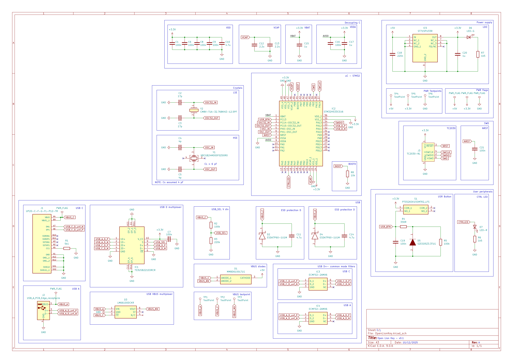
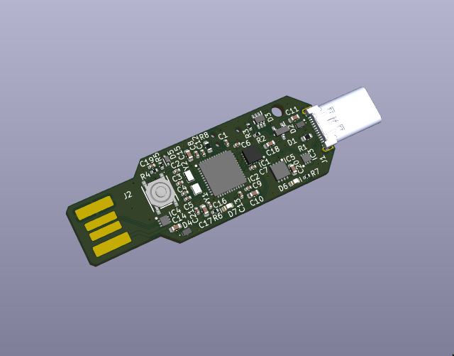
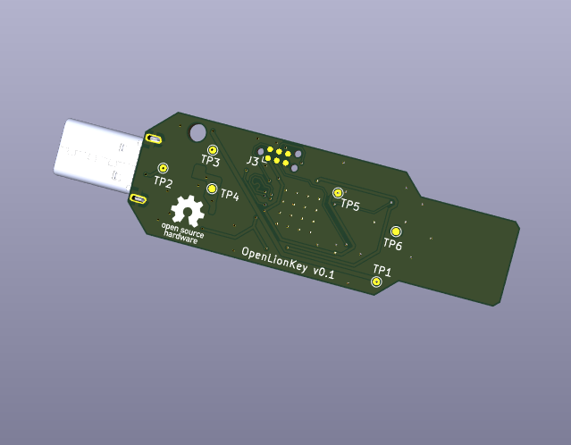
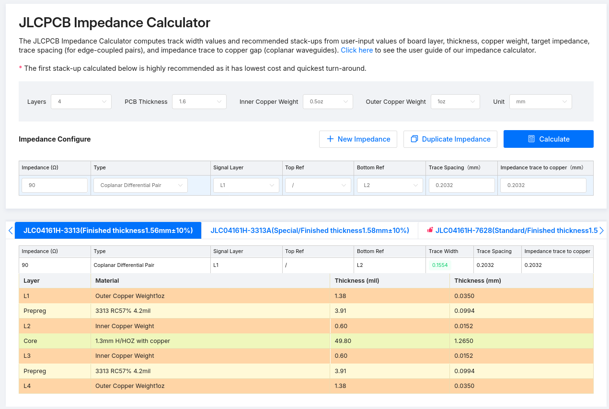

# OpenLionKey 
Minimal open source external authentificator hardware keychain using STM32H533, designed to work with
[LionKey: An open-source FIDO2 USB Security Key](https://github.com/pokusew/lionkey).

Key features:
- minimalistic PCB design (64.5 x 17.5 mm)
- implements STM32H533CEU6 
- features both USB A and USB C
- implements power and data lines switching between the two ports
- SWD via TC2030 connector

## Schematic and visualisations

[Schematic available as pdf](presentation/OpenLionKey_schematic_v0_1.pdf)

## Manufacturing notes
### Differential pair
  The design features a differential pair for the USB D+/- lines. Adjust the thickness and clearance
  to the material of your manufacturer e.g. for JLC PCB specify the material as JLC04161H-3313
  

### PCB thickness
  The design features an PCB edge USB A connector. [Standard](https://www.usb.org/sites/default/files/CCWG_A_Plug_Form_Factor_Guideline_Revision_1.0_.pdf) 
  requires PCB thickness of 2 mm for proper connection in the connector. Either redo the PCB, or 
  adjust the thickness otherwise (will be addressed in forthcoming case).

### Stencil 
  For easier assembly, a PCB and solder paste stencil housing 3D models are available. Suggested stencil size is 75 x 40 mm.

## Licensing
Here presented hardware is available as [Open source hardware](https://oshwa.org/resources/open-source-hardware-definition/) under the [CERN-OHL-S](https://cern-ohl.web.cern.ch/) license.

## Future works 
- [x] first assembly and testing - published version works
- [x] 3D printed case design - case files available in [3D_models](3D_models/) 
- [ ] update an inner layer to power plane
- [ ] check necessity of components (implemented according to [.ioc](https://github.com/pokusew/lionkey/blob/main/targets/stm32h533/stm32h533.ioc))
- [ ] update power switching mechanism

